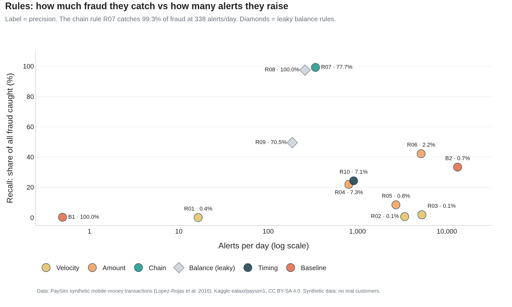
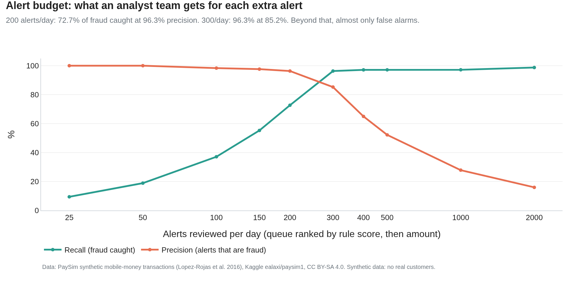
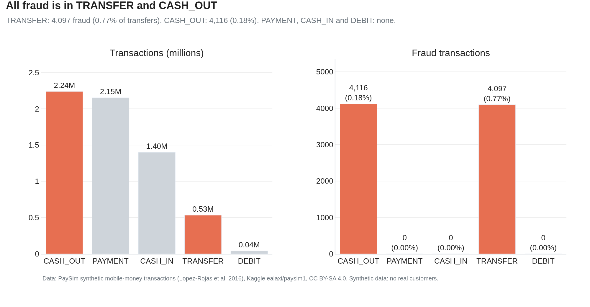
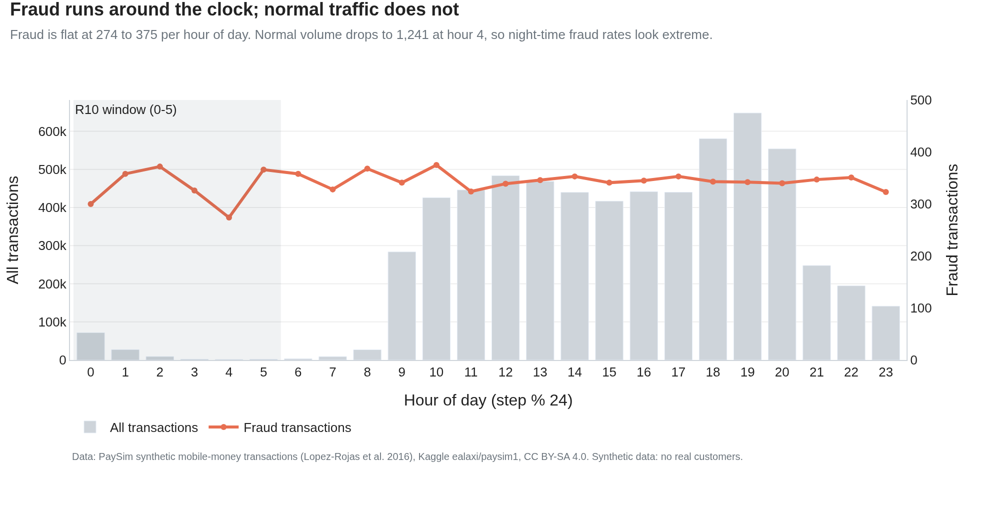
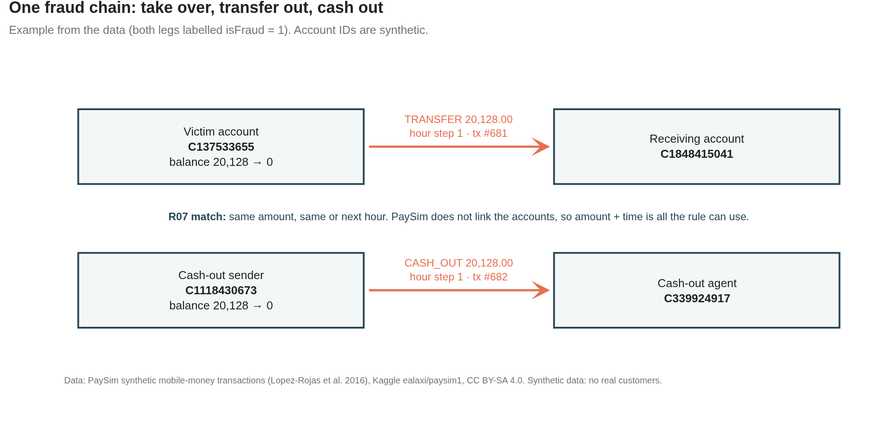
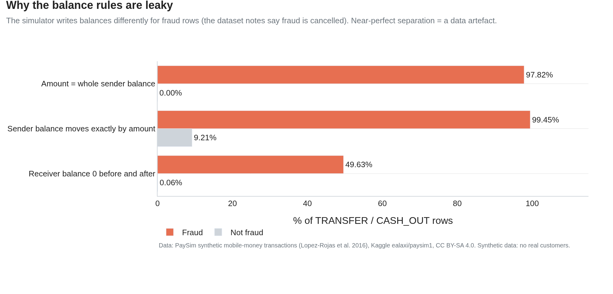

# Transaction monitoring on PaySim: rule-based fraud flags and an alert budget

A fraud/risk analyst take-home, done end to end: write transaction-monitoring rules in SQL, measure each rule's
precision, recall and alert volume against the fraud label, compare them with the dataset's built-in flag,
and recommend what an alert team should actually review. 6,362,620 synthetic mobile-money transactions,
DuckDB SQL, Polars, Plotly, a Streamlit dashboard and a one-page memo ([MEMO.md](MEMO.md)).

**The data is synthetic.** PaySim is a simulator built from one month of real logs of a mobile-money service in an
African country. No row is a real customer, and some patterns below are clearly simulator behaviour. I say so where it matters.



## Case prompt

The kind of task fintech fraud/risk analyst candidates get (payments, neobanks, brokers):

> You join the transaction-monitoring team. Here is one month of transactions with a fraud label.
> 1. Design simple, explainable rules that flag suspicious transactions (velocity, amounts, money-mule chains,
>    balance anomalies, timing).
> 2. For each rule and for your combined rule set: how much fraud does it catch, how many alerts does it create,
>    and how many of those alerts are real fraud?
> 3. The team can review a limited number of alerts per day. What do you keep, at what threshold, and what are
>    the risks of your approach?

## Data source

| | |
|---|---|
| Dataset | *Synthetic Financial Datasets For Fraud Detection* (PaySim), Kaggle [`ealaxi/paysim1`](https://www.kaggle.com/datasets/ealaxi/paysim1), by Edgar Lopez-Rojas, file `PS_20174392719_1491204439457_log.csv` |
| License | **CC BY-SA 4.0**, as listed on the Kaggle dataset. Checked through Kaggle's public API (`licenseName: "CC BY-SA 4.0"`), saved in [docs/kaggle_dataset_metadata.json](docs/kaggle_dataset_metadata.json) |
| Paper | E. A. Lopez-Rojas, A. Elmir, S. Axelsson. "PaySim: A financial mobile money simulator for fraud detection". 28th European Modeling and Simulation Symposium (EMSS), Larnaca, Cyprus, 2016, pp. 249-255. [PDF](https://www.msc-les.org/proceedings/emss/2016/EMSS2016_249.pdf) |
| Download used here | Public Hugging Face mirror [`vitaliy-sharandin/synthetic-fraud-detection`](https://huggingface.co/datasets/vitaliy-sharandin/synthetic-fraud-detection) at revision `8ca94d2`, no login needed. Same file name, and the size (493,534,783 bytes) equals the size Kaggle reports for the original. SHA-256 `16910f90...4eea6b` is checked on download |

The raw CSV (494 MB) is not in this repo. `make data` downloads it. Only code, SQL, aggregated tables and charts are
committed. The aggregated tables in `exports/` and `tableau/` are derived from PaySim, so they are shared under the
same CC BY-SA 4.0 license; the code is MIT.

What is in the file: 6,362,620 rows, `step` 1 to 743 (one step = one hour, 31 days), five transaction types,
sender and receiver IDs, balances before and after for both sides, `isFraud` (8,213 rows, 0.129%) and
`isFlaggedFraud` (16 rows). The Kaggle notes say fraud transactions are cancelled, so the balance columns should
not be used for detection. That matters a lot below.

## How to run

```bash
make all          # venv, download (494 MB), build, evaluate, charts, Tableau extract, tests
make dashboard    # Streamlit dashboard on http://localhost:8501
```

Python 3.11+ and GNU make. After the download, `make build evaluate charts tableau` takes well under a minute.
The dashboard reads only `exports/*.csv` and `docs/findings.json`, which are committed, so
`pip install -r requirements.txt && streamlit run app.py` works on a fresh clone without the raw data.

| Step | Script | Output |
|---|---|---|
| data | `src/download.py` | `data/raw/PS_20174392719_1491204439457_log.csv` (pinned revision, size + SHA-256 checked) |
| build | `src/build.py` + `sql/01..08_*.sql` | Polars CSV → Parquet with a `tx_id`; DuckDB builds staging, every rule table and `fct_alerts` (one row per transaction, one column per rule) in `data/paysim.duckdb` |
| evaluate | `src/evaluate.py` | `exports/rule_metrics.csv`, `combined_metrics.csv`, `alert_budget_curve.csv`, descriptive tables, `docs/findings.json` |
| charts | `src/charts.py` | `docs/charts/*.png` |
| tableau | `src/tableau_extract.py` | `tableau/paysim_fraud_monitoring.xlsx` (16 KB, 10 sheets) |
| test | `tests/test_pipeline.py` | SQL rules on a hand-made fixture, full-build row counts, export consistency, doc numbers, xlsx, dashboard |

## The rules

Monitoring scope: TRANSFER and CASH_OUT, i.e. money leaving an account (2,770,409 rows). In this data every fraud
row is one of those two types, so the scope itself is informed by the label. In practice you would pick it from the
fraud typology (account takeover → move money out → cash out). Thresholds were set by hand before looking at
precision or recall, except C2b below.

| Rule | SQL | Logic |
|---|---|---|
| R01 Sender velocity | `02_velocity.sql` | sender makes 2+ transactions in the same day |
| R02 Receiver velocity (hour) | `02_velocity.sql` | receiver gets 3+ incoming transactions in the same step |
| R03 Receiver velocity (day) | `02_velocity.sql` | receiver gets 10+ incoming transactions in the same day |
| R04 Amount > p99 of type | `03_amount.sql` | amount above the 99th percentile of its own type (unsupervised) |
| R05 Amount vs receiver history | `03_amount.sql` | receiver has 3+ earlier incoming transactions and the amount is over 5x their mean |
| R06 New payee, large | `03_amount.sql` | receiver has never received money before and amount ≥ 200,000 |
| R07 TRANSFER → CASH_OUT chain | `04_chains.sql` | a TRANSFER and a CASH_OUT of exactly the same amount in the same or the next step; both legs flagged |
| R08 Sender drained to 0 (leaky) | `05_balance.sql` | amount equals the sender's whole balance and the balance ends at 0 |
| R09 Receiver balance stays 0 (leaky) | `05_balance.sql` | customer receiver shows 0 before and after a positive transfer |
| R10 Night hours | `06_timing.sql` | `step % 24` between 0 and 5 |
| B1 isFlaggedFraud | `07_baselines.sql` | the simulator's own flag |
| B2 TRANSFER > 200k | `07_baselines.sql` | the rule the dataset description gives for that flag |

**Velocity, honestly:** 99.85% of the 6,353,307 senders appear exactly once (the most any sender has is 3), so
sender velocity and sender history cannot work on PaySim. I kept R01 to show that, and moved velocity and history
to the receiver side, where 83.12% of 2,722,362 receivers appear once and the busiest has 113 incoming transactions.

## Results

All numbers below are printed by `src/evaluate.py` (`exports/rule_metrics.csv`). Precision = share of alerts that
are fraud; recall = share of all 8,213 fraud transactions that the rule flags; alerts per day = alerts / 31 days.

| Rule | Alerts | Fraud caught | Precision | Recall | Alerts/day | Precision days 0-15 / 16-30 |
|---|---:|---:|---:|---:|---:|---|
| R01 Sender velocity | 513 | 2 | 0.39% | 0.02% | 16.5 | 0.21% / 2.78% |
| R02 Receiver velocity (hour) | 104,494 | 50 | 0.05% | 0.61% | 3,370.8 | 0.05% / 0.0% |
| R03 Receiver velocity (day) | 163,012 | 150 | 0.09% | 1.83% | 5,258.5 | 0.09% / no alerts |
| R04 Amount > p99 of type | 24,818 | 1,806 | 7.28% | 21.99% | 800.6 | 4.12% / 33.84% |
| R05 Amount > 5x receiver history | 83,448 | 695 | 0.83% | 8.46% | 2,691.9 | 0.51% / 3.0% |
| R06 New payee, ≥ 200k | 159,812 | 3,467 | 2.17% | 42.21% | 5,155.2 | 1.26% / 8.14% |
| **R07 TRANSFER → CASH_OUT chain** | **10,491** | **8,153** | **77.71%** | **99.27%** | **338.4** | 64.74% / 99.09% |
| R08 Sender drained to 0 (leaky) | 8,008 | 8,008 | 100.0% | 97.5% | 258.3 | 100.0% / 100.0% |
| R09 Receiver stays 0 (leaky) | 5,776 | 4,070 | 70.46% | 49.56% | 186.3 | 55.61% / 98.31% |
| R10 Night hours 0-5 | 28,065 | 1,996 | 7.11% | 24.3% | 905.3 | 4.45% / 16.05% |
| B1 isFlaggedFraud | 16 | 16 | 100.0% | 0.19% | 0.5 | 100.0% / 100.0% |
| B2 TRANSFER > 200k | 409,110 | 2,740 | 0.67% | 33.36% | 13,197.1 | 0.39% / 2.51% |

Combined rule sets (`exports/combined_metrics.csv`):

| Rule set | Alerts | Precision | Recall | Alerts/day |
|---|---:|---:|---:|---:|
| C1 Chain + at least one more safe rule | 6,682 | 82.97% | 67.5% | 215.5 |
| C2 Chain rule alone (R07) | 10,491 | 77.71% | 99.27% | 338.4 |
| C2b Chain rule, amount below 10,000,000 | 8,080 | 97.35% | 95.77% | 260.6 |
| C3 Any 2+ safe rules | 14,649 | 37.87% | 67.54% | 472.5 |
| C4 Chain OR amount p99 OR night | 59,379 | 13.74% | 99.34% | 1,915.5 |
| C5 Union of all safe rules | 289,554 | 2.82% | 99.55% | 9,340.5 |
| C6 Union incl. leaky balance rules | 291,111 | 2.81% | 99.55% | 9,390.7 |

"Safe" = R04, R05, R06, R07, R10 (no balance columns).

### What I found

1. **The built-in flag barely does anything.** `isFlaggedFraud` fires 16 times, all fraud: 100% precision but
   0.19% recall. The rule the dataset describes for it (TRANSFER > 200k) would raise 13,197.1 alerts a day at 0.67%
   precision and still miss two thirds of the fraud.
2. **The chain rule carries the whole system.** A TRANSFER and a CASH_OUT of the same amount within an hour catches
   99.27% of fraud at 77.71% precision, about 338 alerts a day. The match is on amount and time only: in none of the
   matched pairs is the cash-out sender the transfer receiver, so there is no account link to follow. 94.59% of fraud pairs
   even sit in consecutive rows of the log. That is a simulator pattern; real mules split amounts and wait.
3. **Most of the chain rule's false alarms are one amount.** 90.85% of its 2,338 false positives are transactions of
   exactly 10,000,000, which looks like the simulator's per-transaction cap. Excluding that amount (C2b) gives 97.35%
   precision at 95.77% recall. I picked that cut after looking at the labels, so treat it as a lead to check, not a
   tested threshold.
4. **The balance rules are leaky.** "Amount equals the whole sender balance" is true for 97.82% of fraud rows and
   0.00% of normal rows ([chart](docs/charts/06_leakage_check.png)). R08 looks perfect (100% precision, 97.5% recall)
   because the simulator writes balances differently for fraud, not because it is a good rule. Adding R08 and R09 to
   the safe rules raises recall by 0 transactions. I do not recommend them.
5. **Timing and amount help with ranking, not as standalone rules.** Fraud is flat across the day (274 to 375 per
   hour of day) while normal volume falls to 1,241 at hour 4, so 24.3% of fraud happens at hours 0-5 versus 1.77% of
   all transactions. As rules on their own, R10 and R04 run at about 7% precision and 800-900 alerts a day. R04 also
   cannot flag a single fraud TRANSFER, because the TRANSFER p99 is exactly the 10,000,000 cap.
6. **Precision depends on which days you look at.** Normal daily volume swings from 282 to 571,039 transactions,
   while fraud stays between 220 and 316 a day ([chart](docs/charts/07_daily_volume.png)). The same chain rule runs at
   64.74% precision in days 0-15 and 99.09% in days 16-30.

### Alert budget

If the team can review N alerts a day, rank each day's in-scope transactions by a simple score (3 points for the
chain rule, 1 each for R04, R05, R06, R10), then by amount, and review the top N (`exports/alert_budget_curve.csv`):

| Alerts reviewed per day | 100 | 200 | 300 | 500 | 1,000 |
|---|---:|---:|---:|---:|---:|
| Recall | 37.11% | 72.7% | 96.3% | 97.15% | 97.18% |
| Precision | 98.32% | 96.31% | 85.24% | 52.22% | 27.85% |



Past about 300 a day almost every extra alert is a false alarm. The recommendation and the caveats are in
[MEMO.md](MEMO.md).

## Charts

| | |
|---|---|
|  |  |
|  |  |

## Dashboard

- Streamlit (`make dashboard`): rule scorecard, a rule builder (pick rules, "at least k of them", day range;
  computed from `exports/rule_combo_cube.csv`), the alert budget, fraud patterns, a chain example and the leakage check.
- Tableau Public: [PaySim transaction monitoring: which rules to keep](https://public.tableau.com/app/profile/abhiram.ramakrishnan3146/viz/PaySimtransactionmonitoringwhichrulestokeep/Whichrule) (built from `tableau/paysim_fraud_monitoring.xlsx`
  following [tableau/BUILD_SPEC.md](tableau/BUILD_SPEC.md)).

## Limits

- Synthetic data. Fraud in PaySim follows one scripted pattern (take over, transfer out, cash out of the same amount),
  so a rule written for that pattern looks far better than it would on real traffic.
- The label is the simulator's ground truth, available instantly. Real fraud labels arrive late (chargebacks,
  customer reports) and are incomplete.
- One month, one run of the simulator. There is no out-of-time test on new data; the two halves of the month are the
  closest I have, and their normal volumes differ a lot.
- `hour = step % 24` assumes step 0 is midnight. The dataset does not say so; the night-time dip in volume suggests it
  is roughly right.
- 16 fraud rows have an amount of 0. I kept them as labelled.

## Repository layout

```
sql/          01_staging … 08_alerts: every rule in DuckDB SQL
src/          download, build, rules registry, evaluate, figures, charts, tableau_extract
exports/      aggregated CSVs (committed; the dashboard reads these)
docs/         findings.json, kaggle_dataset_metadata.json (license evidence), charts/*.png
tableau/      paysim_fraud_monitoring.xlsx + BUILD_SPEC.md
tests/        pytest
app.py        Streamlit dashboard
MEMO.md       alert-triage recommendation
```

## License and attribution

Code: MIT ([LICENSE](LICENSE)). Data: PaySim by Edgar Lopez-Rojas et al., Kaggle `ealaxi/paysim1`, CC BY-SA 4.0.
Derived tables in `exports/` and `tableau/` are shared under CC BY-SA 4.0. Please cite the PaySim paper above when
using the data.
